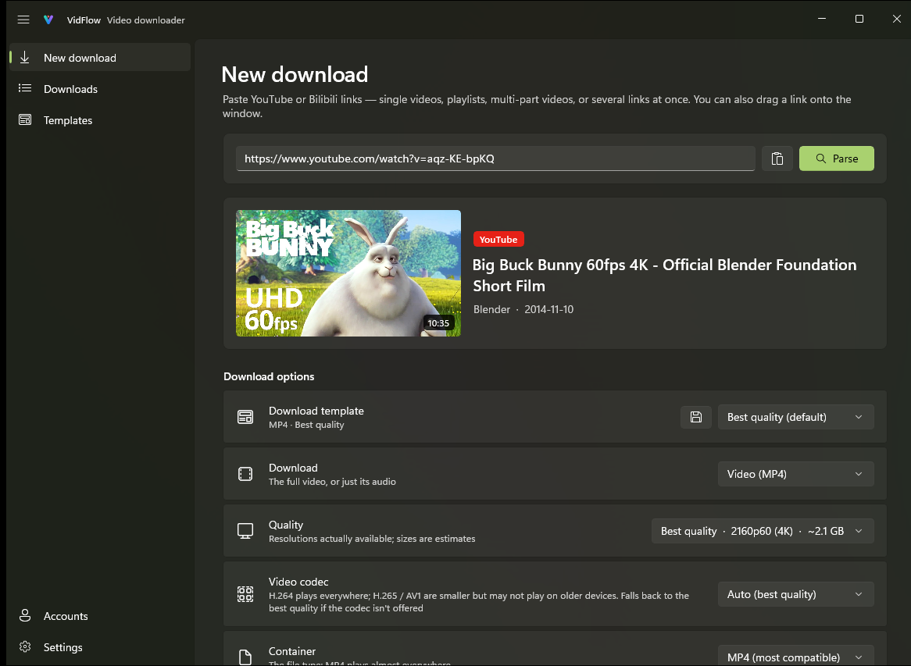
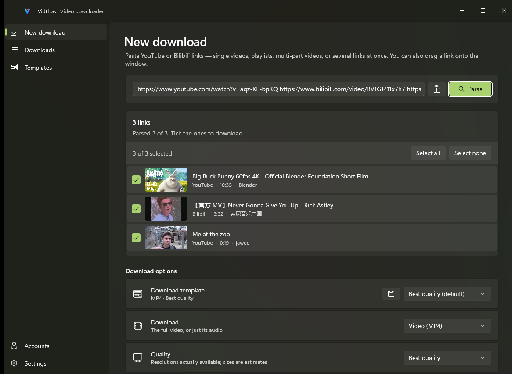
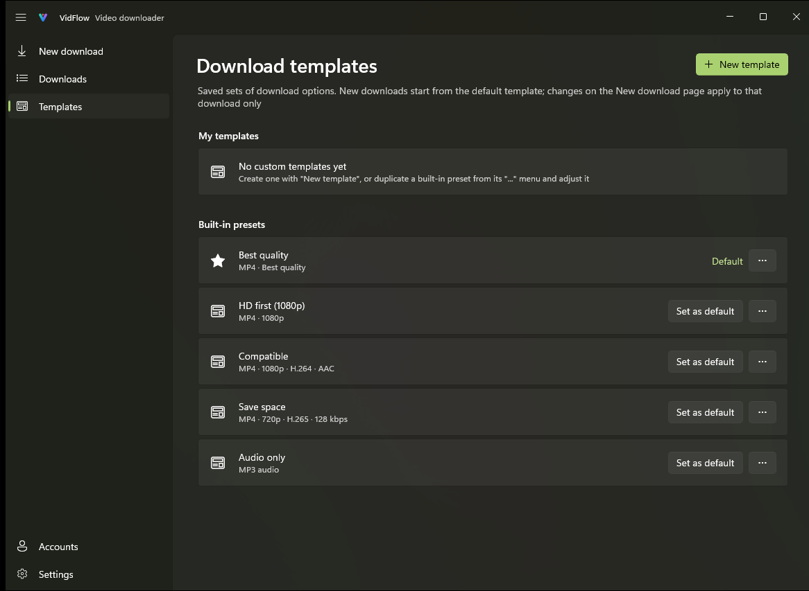
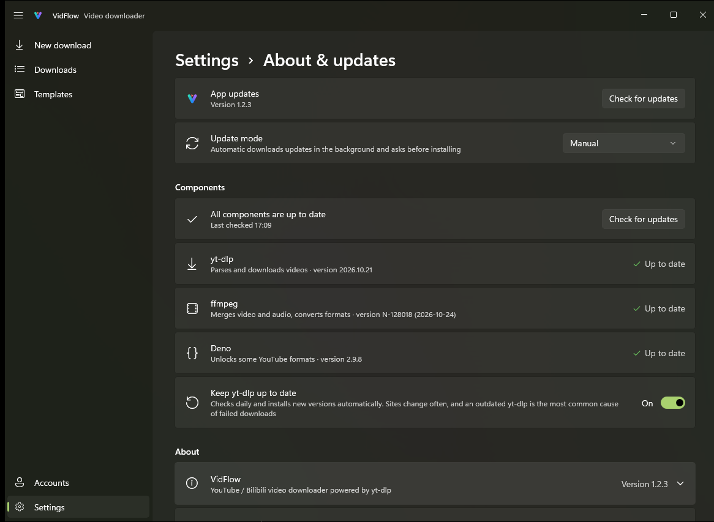

<p align="center">
  
</p>

<h1 align="center">VidFlow</h1>

<p align="center">
  <b>A good-looking, easy video downloader for Windows: paste a link, pick the quality, done.</b><br>
  YouTube, Bilibili and Douyin · Native Windows 11 design · Powered by yt-dlp
</p>

<p align="center">
  <a href="https://github.com/Magicherry/VidFlow/releases/latest"></a>
  <a href="https://github.com/Magicherry/VidFlow/releases"></a>
  
</p>

<p align="center">
  <a href="README.md">简体中文</a> · <b>English</b>
</p>

<p align="center">
  <a href="https://github.com/Magicherry/VidFlow/releases/latest"><b>⬇ Download VidFlow</b></a>
</p>

<p align="center">
  
</p>

## Why VidFlow

- **Top quality in one go**: picks the highest-bitrate stream at the resolution you choose; 4K and 60 fps come down as published, with no re-encoding by default.
- **Feels like part of Windows**: Mica, light and dark themes, notifications, taskbar progress and tray downloads, right at home on Windows 11.
- **Ready out of the box**: yt-dlp, ffmpeg and Deno install with one click and check for updates in the app; yt-dlp also keeps itself current. No command line.
- **Sign in for more**: scan a QR code with the Bilibili app to unlock 1080P and above; sign in to YouTube for age-restricted and members-only videos.
- **Your data stays on your PC**: sign-ins and download history are stored locally, and the app collects no usage data.

## Features

### Downloading
- Single videos, playlists, Bilibili multi-part videos (pick the parts you want), and Douyin videos (share text and short links work too)
- Paste several links at once: each is parsed and listed with its title, cover and length, and you tick the ones to download
- The quality list shows the resolutions actually available, with estimated sizes
- Video codec: H.264 / H.265 / AV1; container: MP4 / MKV / WebM; or audio only as MP3 / M4A / Opus / FLAC / WAV
- Choose the audio track on videos with several dubs; save subtitles and Bilibili danmaku
- Warns about incompatible format combinations and fixes them in one click

### Download templates
- Five built-in presets: Best quality, HD first, Compatible, Save space, Audio only
- Your own templates: save your usual quality, format and naming, and make one the default
- Build file names from {title}, {uploader}, {upload date}, {resolution} and more, sort into subfolders by platform, uploader or date, and preview the resulting path as you type

### Managing downloads
- A queue with pause, resume (continues partial files), retry, download next, speed limit and parallel downloads
- Smooth, accurate progress: video and audio share one bar that never jumps back
- Keeps downloading from the tray after you close the window; notifies you when downloads finish or fail
- The download list survives restarts, and unfinished downloads pick up where they left off

### Thoughtful details
- Drag a link onto the window to download it; optionally watch the clipboard for copied links
- VidFlow updates itself: checks in the background, verifies the download, and rolls back if an update fails
- Chinese and English UI, with a setup wizard on first launch

## Screenshots

<table>
  <tr>
    <td width="50%"><br><sub>Paste several links and tick the ones to download</sub></td>
    <td width="50%"><br><sub>Download templates: built-in presets and your own</sub></td>
  </tr>
  <tr>
    <td width="50%"><br><sub>App and component updates, checked in one click</sub></td>
    <td width="50%" align="center"><br><sub>Bilibili QR sign-in</sub></td>
  </tr>
</table>

## Download and install

1. Download `VidFlow-Setup-<version>-x64.exe` from [Releases](https://github.com/Magicherry/VidFlow/releases/latest).
2. Run it. It installs for the current user, so no administrator rights are needed.
3. Follow the setup wizard on first launch; VidFlow downloads the components it needs.

**Requirements**: Windows 10 2004 (19041) or later, x64. Best on Windows 11.

## Getting started

1. Copy a video link and paste it into **New download**, or drag the link onto the window.
2. Click **Parse**, then choose the quality and format, or just use a download template.
3. Click **Download** and follow the progress under **Downloads**.

## FAQ

<details>
<summary><b>Bilibili only offers 480P / 720P?</b></summary>

Without signing in, Bilibili serves lower qualities only. Sign in on the **Accounts** page by scanning the QR code with the Bilibili app to get 1080P and above (4K / HDR need a premium membership).
</details>

<details>
<summary><b>YouTube fails to parse, or is very slow?</b></summary>

Reaching YouTube may need a proxy: enter it under **Settings → Network** (leave it empty to use the system proxy). If YouTube asks to confirm you're not a bot, sign in on the **Accounts** page.
</details>

<details>
<summary><b>A download fails with "format not available"?</b></summary>

Sites change often. Check for component updates under **Settings → About & updates** (keeping **Keep yt-dlp up to date** on is recommended).
</details>

<details>
<summary><b>Where is my data, and how do I remove it completely?</b></summary>

Settings, download history, sign-ins and components live in `%LocalAppData%\VidFlow`. When you uninstall VidFlow from Windows **Apps**, you can choose to delete them too; downloaded videos are never touched.
</details>

## Disclaimer

VidFlow is for personal use and backups. Only download content you have the right to save, and follow each platform's terms of service and copyright rules.

## Thanks

VidFlow stands on the shoulders of these great projects: [yt-dlp](https://github.com/yt-dlp/yt-dlp) · [FFmpeg](https://ffmpeg.org/) · [Deno](https://deno.com/) · [Windows App SDK](https://github.com/microsoft/WindowsAppSDK) · [Windows Community Toolkit](https://github.com/CommunityToolkit/Windows) · [H.NotifyIcon](https://github.com/HavenDV/H.NotifyIcon) · [QRCoder](https://github.com/codebude/QRCoder)

---

<details>
<summary><b>For developers</b></summary>

### Layout

| Path | What |
|---|---|
| `VidFlow/` | WinUI 3 app (pages, windows, tray / notifications / taskbar integration) |
| `VidFlow.Core/` | UI-free logic: yt-dlp arguments and output parsing, settings, persistence, localization |
| `VidFlow.Tests/` | Unit tests for `VidFlow.Core` (xunit v3) |
| `VidFlow.Core/Localization/Strings.tsv` | All UI strings (key, English, Chinese), the source of the `.resx` files |
| `branding/` | Vector sources of the app icon |
| `installer/VidFlow.iss` | Inno Setup script (per-user install) |
| `tools/` | `gen-strings.ps1`, `gen-icon.ps1`, `build-release.ps1` |

### Build and test

Requires the .NET 10 SDK.

```powershell
dotnet build VidFlow/VidFlow.csproj -p:Platform=x64
dotnet test --project VidFlow.Tests/VidFlow.Tests.csproj
```

After editing `Strings.tsv`, run `pwsh tools/gen-strings.ps1`; after editing the icon in `branding/`, run `pwsh tools/gen-icon.ps1`.

### Release

Requires [Inno Setup 6](https://jrsoftware.org/isinfo.php) (`winget install JRSoftware.InnoSetup`). Bump `<Version>` in `VidFlow/VidFlow.csproj`, then:

```powershell
pwsh tools/build-release.ps1
```

It runs the tests, publishes a trimmed self-contained x64 build to `VidFlow-Release/`, and writes the installer plus the `update.json` used by auto-update to `dist/` (upload both to the GitHub release).

</details>
