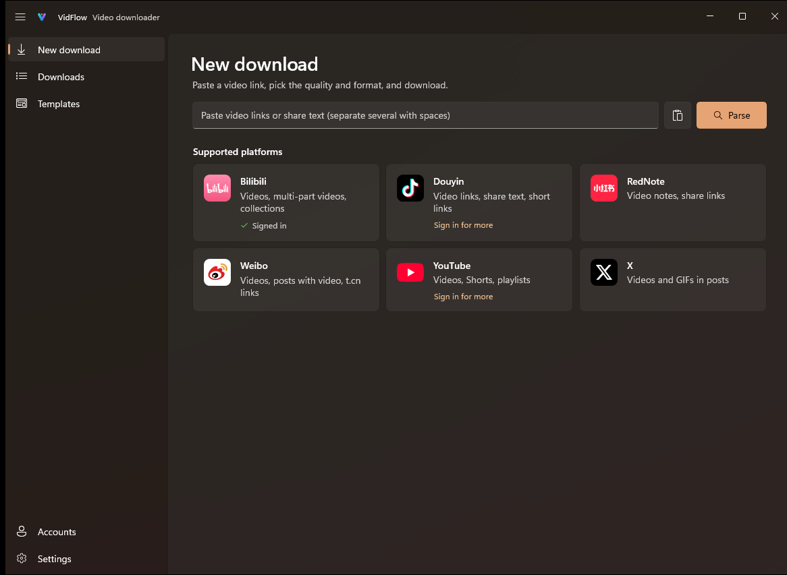

<div align="center">


<h1>VidFlow</h1>

<p><b>A video downloader built for Windows 11</b></p>

<p>Paste a link, pick the quality, download.<br>Works with Bilibili, Douyin, RedNote (Xiaohongshu), Weibo, YouTube and X.</p>

<p>
  <a href="https://github.com/Magicherry/VidFlow/releases/latest"></a>
  <a href="https://github.com/Magicherry/VidFlow/releases/latest"></a>
</p>

<p>
  <a href="https://github.com/Magicherry/VidFlow/releases/latest"></a>
  <a href="https://github.com/Magicherry/VidFlow/releases"></a>
  
</p>

<p><a href="README.md">简体中文</a> · <b>English</b></p>

<br>


</div>

## Highlights

- **Original quality**: picks the highest-bitrate stream at each resolution; 4K, 60 fps, HDR and Dolby Vision are saved as published, with no re-encoding by default.
- **Native on Windows 11**: Mica, light and dark themes, notifications and taskbar progress; downloads keep going from the tray after you close the window.
- **Ready out of the box**: yt-dlp, ffmpeg and the other components install with one click and keep themselves up to date. No command line.
- **Faster downloads**: multi-connection acceleration (aria2) for YouTube and other overseas sites.
- **Sign in for more**: scan a QR code with the Bilibili app for 1080p and above; sign in to YouTube for age-restricted and members-only videos.
- **Your data stays on your PC**: sign-ins and download history are stored locally, and no usage data is collected.

## Features

- **Links**: single videos, playlists, Bilibili multi-part videos and collections, Douyin share text and short links; paste several links at once and tick the ones you want
- **Content**: video, audio only (MP3 / M4A / Opus / FLAC / WAV) or just the cover image
- **Formats**: qualities listed as actually available, with estimated sizes; H.264 / H.265 / AV1 in MP4 / MKV / WebM; incompatible combinations are flagged and fixed in one click
- **Extras**: audio tracks in other languages, subtitles, Bilibili danmaku, embedded cover, metadata and chapters; SponsorBlock marks or cuts sponsor segments on YouTube
- **Templates and naming**: five built-in templates plus your own; name files from {title}, {uploader}, {upload date} and more, and sort them by platform, uploader or date
- **Queue**: pause and resume, retry, speed limit, parallel downloads; unfinished downloads continue after a restart
- **Convenience**: drag a link onto the window or let VidFlow watch the clipboard; the app updates itself and rolls back if an update fails; Chinese and English UI

## Screenshots

<table>
  <tr>
    <td width="33%"><br><sub>Supported platforms</sub></td>
    <td width="33%"><br><sub>Several links at once</sub></td>
    <td width="33%"><br><sub>Download templates</sub></td>
  </tr>
</table>

## Install

Download the installer from [Releases](https://github.com/Magicherry/VidFlow/releases/latest), run it, and follow the setup wizard on first launch. It installs for the current user, so no administrator rights are needed.

| Installer | For | Requires |
|---|---|---|
| `VidFlow-Setup-<version>-x64.exe` | Most PCs | Windows 10 2004 (19041) or later |
| `VidFlow-Setup-<version>-arm64.exe` | ARM PCs (such as Snapdragon X) | Windows 11 |

## FAQ

<details>
<summary><b>Bilibili only offers 480p / 720p?</b></summary>

Without signing in, Bilibili serves lower qualities only. Sign in on the **Accounts** page by scanning the QR code with the Bilibili app to get 1080p and above (4K / HDR need a premium membership).
</details>

<details>
<summary><b>YouTube fails to parse, or is very slow?</b></summary>

Reaching YouTube may need a proxy: enter it under **Settings → Network and speed** (leave it empty to use the system proxy). If YouTube asks to confirm you're not a bot, sign in on the **Accounts** page.
</details>

<details>
<summary><b>A download fails with "format not available"?</b></summary>

Sites change often. Check for component updates under **Settings → About & updates** (keeping **Update components automatically** on is recommended).
</details>

<details>
<summary><b>Where is my data, and how do I remove it completely?</b></summary>

Settings, download history, sign-ins and components live in `%LocalAppData%\VidFlow`. When you uninstall VidFlow from Windows **Apps**, you can choose to delete them too; downloaded videos are never touched.
</details>

## Disclaimer

VidFlow is for personal use and backups. Only download content you have the right to save, and follow each platform's terms of service and copyright rules. Platform names and logos belong to their owners and are used only to identify those platforms.

## Thanks

[yt-dlp](https://github.com/yt-dlp/yt-dlp) · [FFmpeg](https://ffmpeg.org/) · [aria2](https://github.com/aria2/aria2) · [Deno](https://deno.com/) · [Windows App SDK](https://github.com/microsoft/WindowsAppSDK) · [Windows Community Toolkit](https://github.com/CommunityToolkit/Windows) · [H.NotifyIcon](https://github.com/HavenDV/H.NotifyIcon) · [QRCoder](https://github.com/codebude/QRCoder)

---

<details>
<summary><b>For developers</b></summary>

### Layout

| Path | What |
|---|---|
| `VidFlow/` | WinUI 3 app (pages, windows, tray / notifications / taskbar integration) |
| `VidFlow.Core/` | UI-free logic: yt-dlp arguments and output parsing, settings, persistence, localization |
| `VidFlow.Tests/` | Unit tests for `VidFlow.Core` (xunit v3) |
| `VidFlow.Core/Localization/Strings.tsv` | All UI strings (key, English, Chinese), the source of the `.resx` files |
| `branding/` | Vector sources of the app icon |
| `installer/VidFlow.iss` | Inno Setup script (per-user install) |
| `tools/` | `gen-strings.ps1`, `gen-icon.ps1`, `build-release.ps1` |

### Build and test

Requires the .NET 10 SDK.

```powershell
dotnet build VidFlow/VidFlow.csproj -p:Platform=x64
dotnet test --project VidFlow.Tests/VidFlow.Tests.csproj
```

After editing `Strings.tsv`, run `pwsh tools/gen-strings.ps1`; after editing the icon in `branding/`, run `pwsh tools/gen-icon.ps1`.

### Release

Requires [Inno Setup 6](https://jrsoftware.org/isinfo.php) (`winget install JRSoftware.InnoSetup`). Bump `<Version>` in `VidFlow/VidFlow.csproj`, then:

```powershell
pwsh tools/build-release.ps1
```

It runs the tests, publishes trimmed self-contained x64 and ARM64 builds, and writes both installers plus the `update.json` / `update-arm64.json` manifests used by auto-update to `dist/` (upload them all to the GitHub release). Pass `-Arch x64` or `-Arch arm64` to build just one.

</details>
