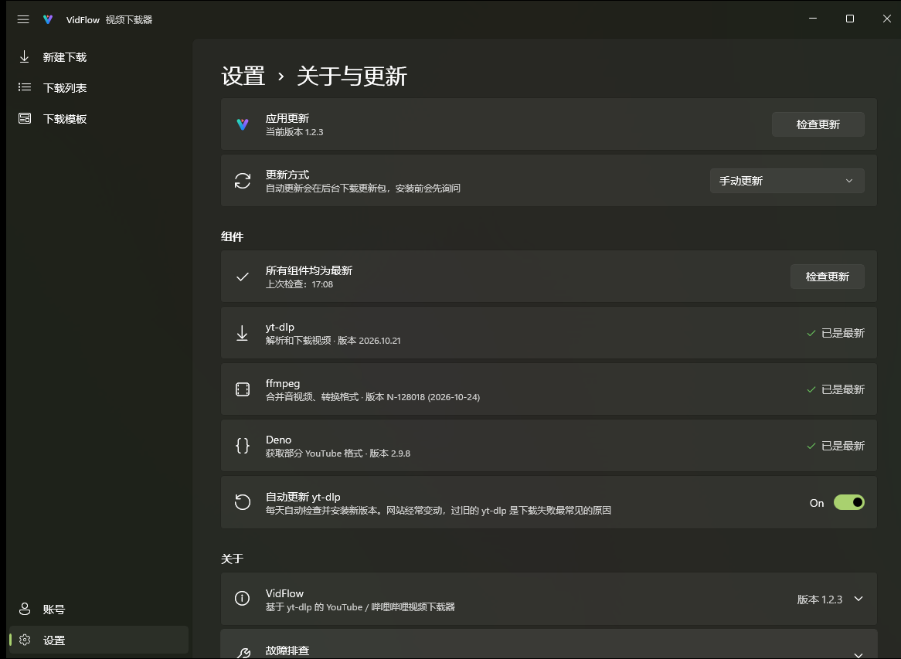

<p align="center">
  
</p>

<h1 align="center">VidFlow</h1>

<p align="center">
  <b>好看、好用的 Windows 视频下载器：粘贴链接，选好画质，交给它。</b><br>
  支持哔哩哔哩、抖音、小红书、微博、YouTube 与 X · Windows 11 原生设计 · 基于 yt-dlp
</p>

<p align="center">
  <a href="https://github.com/Magicherry/VidFlow/releases/latest"></a>
  <a href="https://github.com/Magicherry/VidFlow/releases"></a>
  
</p>

<p align="center">
  <b>简体中文</b> · <a href="README.en.md">English</a>
</p>

<p align="center">
  <a href="https://github.com/Magicherry/VidFlow/releases/latest"><b>⬇ 下载 VidFlow</b></a>
</p>

<p align="center">
  
</p>

## 为什么选择 VidFlow

- **一步到位的高画质**：自动挑选同分辨率下码率最高的视频流，4K / 60fps 原样下载，默认不做二次转码。
- **像系统应用一样顺手**：Mica 材质、深浅色主题、通知、任务栏进度、托盘后台下载，和 Windows 11 浑然一体。
- **开箱即用**：yt-dlp、ffmpeg、Deno 等组件在应用内一键安装、一键检查更新，yt-dlp 还会自动保持最新，无需命令行。
- **登录解锁更多内容**：哔哩哔哩支持 App 扫码登录，解锁 1080P 及以上画质；YouTube 登录后可下载年龄限制与会员专属视频。
- **数据只在本机**：登录信息和下载记录都保存在你的电脑上，应用不收集任何使用数据。

## 功能一览

### 下载
- 单个视频、播放列表、B 站多 P 视频（可勾选分 P）、抖音作品（支持分享口令与短链接）、微博视频、X 帖子中的视频
- 一次粘贴多个链接：逐个解析，列出标题、封面与时长，勾选要下载的项目
- 画质列表显示实际可用的分辨率与预估大小
- 视频编码可选 H.264 / H.265 / AV1；封装格式可选 MP4 / MKV / WebM；也可只下载音频，导出为 MP3 / M4A / Opus / FLAC / WAV
- 多语言配音的视频可选择音轨；可保存字幕与 B 站弹幕
- 格式不兼容时给出提示与一键推荐

### 下载模板
- 内置「最高画质 / 高清优先 / 兼容优先 / 节省空间 / 仅下载音频」五种预设
- 自建模板：保存常用的画质、格式、命名规则，并可设为默认
- 文件命名可用 {标题}、{作者}、{上传日期}、{分辨率} 等变量组合，可按平台、作者或日期自动归类到子文件夹，并实时预览保存路径

### 下载管理
- 下载队列：暂停、继续（断点续传）、重试、优先下载、限速、同时下载数
- 进度平滑准确：视频与音频合并为一条进度，不来回跳动
- 关闭窗口后在托盘继续下载；完成或失败时发送系统通知
- 下载列表在重启后保留，未完成的任务自动继续

### 更省心的细节
- 拖入链接即可下载；可选监听剪贴板，复制链接时弹出提示
- 应用自身自动更新：后台检查，下载前校验，失败自动回滚
- 简体中文 / English 界面，首次启动有设置向导

## 截图

<table>
  <tr>
    <td width="50%"><br><sub>一次粘贴多个链接，勾选要下载的项目</sub></td>
    <td width="50%"><br><sub>下载模板：内置预设与自定义模板</sub></td>
  </tr>
  <tr>
    <td width="50%"><br><sub>应用与组件更新，一键检查</sub></td>
    <td width="50%" align="center"><br><sub>哔哩哔哩扫码登录</sub></td>
  </tr>
</table>

## 下载与安装

1. 前往 [Releases](https://github.com/Magicherry/VidFlow/releases/latest) 下载安装程序：大多数电脑选 `VidFlow-Setup-<版本>-x64.exe`，ARM 电脑（如骁龙 X）选 `-arm64.exe`。
2. 运行安装程序（安装到当前用户，无需管理员权限）。
3. 首次启动按向导完成设置，应用会自动下载所需组件。

**系统要求**：x64 版需 Windows 10 2004（19041）或更高版本；ARM64 版需 Windows 11。Windows 11 体验最佳。

## 快速上手

1. 复制视频链接，粘贴到「新建下载」，或直接把链接拖进窗口。
2. 点击「解析」，选择画质、格式，或直接套用下载模板。
3. 点击「下载」，在「下载列表」中查看进度。

## 常见问题

<details>
<summary><b>B 站最高只能下载 480P / 720P？</b></summary>

未登录时哔哩哔哩只提供较低画质。在「账号」页面用 App 扫码登录即可下载 1080P 及以上画质（4K / HDR 等需要大会员）。
</details>

<details>
<summary><b>YouTube 解析失败或很慢？</b></summary>

访问 YouTube 可能需要代理：在「设置 → 网络」中填写代理地址，留空则使用系统代理。若提示需要验证身份，可在「账号」页面登录 YouTube。
</details>

<details>
<summary><b>下载失败，提示格式不可用？</b></summary>

网站经常变动，请到「设置 → 关于与更新」检查组件更新（建议开启「自动更新 yt-dlp」）。
</details>

<details>
<summary><b>数据保存在哪里？如何彻底卸载？</b></summary>

设置、下载记录、登录信息与组件都保存在 `%LocalAppData%\VidFlow`。在系统「应用」中卸载 VidFlow 时可选择一并删除这些数据；已下载的视频不受影响。
</details>

## 声明

VidFlow 仅供个人学习与备份使用。请只下载你有权保存的内容，并遵守相关平台的服务条款与版权规定。各平台的名称与标志归其各自所有者所有，仅用于标识对应平台。

## 致谢

VidFlow 站在这些优秀项目的肩膀上：[yt-dlp](https://github.com/yt-dlp/yt-dlp) · [FFmpeg](https://ffmpeg.org/) · [Deno](https://deno.com/) · [Windows App SDK](https://github.com/microsoft/WindowsAppSDK) · [Windows Community Toolkit](https://github.com/CommunityToolkit/Windows) · [H.NotifyIcon](https://github.com/HavenDV/H.NotifyIcon) · [QRCoder](https://github.com/codebude/QRCoder)

---

<details>
<summary><b>开发者说明</b></summary>

### 项目结构

| 路径 | 内容 |
|---|---|
| `VidFlow/` | WinUI 3 应用（页面、窗口、托盘 / 通知 / 任务栏集成） |
| `VidFlow.Core/` | 与界面无关的逻辑：yt-dlp 参数与输出解析、设置、持久化、本地化 |
| `VidFlow.Tests/` | `VidFlow.Core` 的单元测试（xunit v3） |
| `VidFlow.Core/Localization/Strings.tsv` | 全部界面文本（键、英文、中文），用于生成 `.resx` |
| `branding/` | 应用图标的矢量源文件 |
| `installer/VidFlow.iss` | Inno Setup 安装脚本（按用户安装） |
| `tools/` | `gen-strings.ps1`、`gen-icon.ps1`、`build-release.ps1` |

### 构建与测试

需要 .NET 10 SDK。

```powershell
dotnet build VidFlow/VidFlow.csproj -p:Platform=x64
dotnet test --project VidFlow.Tests/VidFlow.Tests.csproj
```

修改 `Strings.tsv` 后运行 `pwsh tools/gen-strings.ps1`；修改 `branding/` 中的图标后运行 `pwsh tools/gen-icon.ps1`。

### 发布

需要 [Inno Setup 6](https://jrsoftware.org/isinfo.php)（`winget install JRSoftware.InnoSetup`）。先在 `VidFlow/VidFlow.csproj` 中更新 `<Version>`，然后：

```powershell
pwsh tools/build-release.ps1
```

脚本会运行测试，发布精简的 x64 和 ARM64 独立版本（`VidFlow-Release/`、`VidFlow-Release-arm64/`），并在 `dist/` 生成两个安装程序和自动更新使用的 `update.json`、`update-arm64.json`（一起上传到 GitHub Release）。加 `-Arch x64` 或 `-Arch arm64` 只构建一种。

</details>
