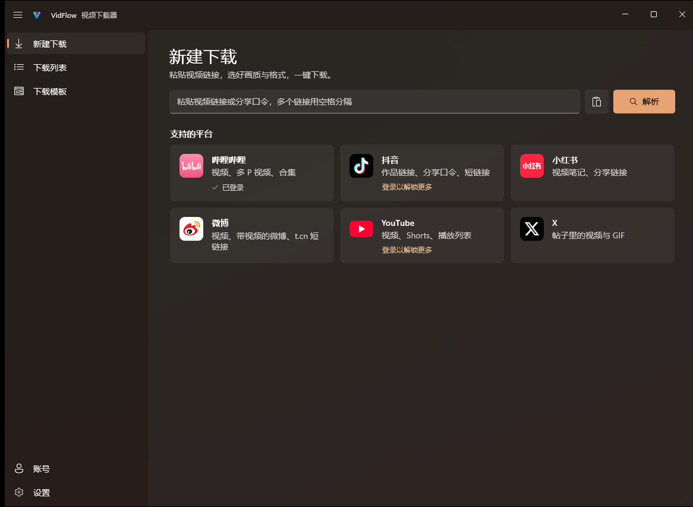
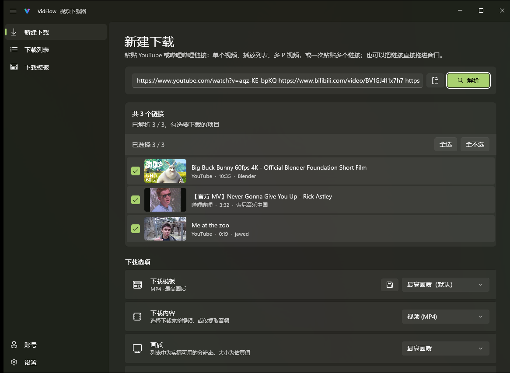
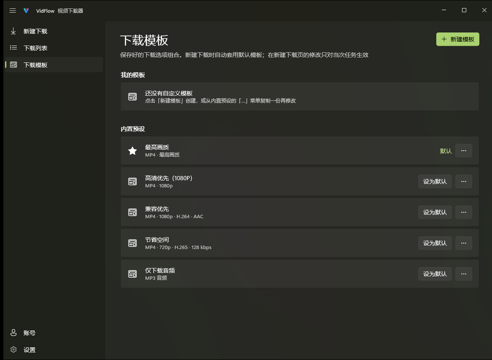

<div align="center">


<h1>VidFlow</h1>

<p><b>为 Windows 11 打造的视频下载器</b></p>

<p>粘贴链接，选好画质，一键下载。<br>支持哔哩哔哩、抖音、小红书、微博、YouTube 与 X。</p>

<p>
  <a href="https://github.com/Magicherry/VidFlow/releases/latest"></a>
  <a href="https://github.com/Magicherry/VidFlow/releases/latest"></a>
</p>

<p>
  <a href="https://github.com/Magicherry/VidFlow/releases/latest"></a>
  <a href="https://github.com/Magicherry/VidFlow/releases"></a>
  
</p>

<p><b>简体中文</b> · <a href="README.en.md">English</a></p>

<br>


</div>

## 亮点

- **原画质下载**：同分辨率下自动挑选码率最高的视频流，4K、60fps、HDR 与杜比视界原样保存，默认不二次转码。
- **原生 Windows 11 体验**：Mica 材质、深浅色主题、系统通知、任务栏进度，关闭窗口后在托盘继续下载。
- **开箱即用**：yt-dlp、ffmpeg 等组件在应用内一键安装并自动保持最新，无需命令行。
- **下载更快**：YouTube 等海外视频支持多连接加速（aria2）。
- **登录解锁更多内容**：哔哩哔哩 App 扫码登录可下载 1080P 及以上画质；YouTube 登录后可下载年龄限制与会员视频。
- **数据只在本机**：登录信息与下载记录都保存在你的电脑上，不收集任何使用数据。

## 功能

- **解析**：单个视频、播放列表、B 站多 P 与合集、抖音分享口令与短链接；一次粘贴多个链接，勾选要下载的项目
- **内容**：视频、仅音频（MP3 / M4A / Opus / FLAC / WAV）或仅封面
- **格式**：画质按实际可用分辨率列出并预估大小；编码可选 H.264 / H.265 / AV1，封装可选 MP4 / MKV / WebM；格式不兼容时给出提示与一键推荐
- **附加内容**：多语言音轨、字幕、B 站弹幕、嵌入封面与元数据、嵌入章节；YouTube 可用 SponsorBlock 标记或删除赞助片段
- **模板与命名**：五种内置预设与自定义模板；用 {标题}、{作者}、{上传日期} 等变量命名，并按平台、作者或日期归类
- **下载管理**：队列、暂停与断点续传、重试、限速、同时下载数；重启后自动继续未完成的任务
- **便捷**：拖入链接即可下载，可监听剪贴板；应用自动更新，失败自动回滚；简体中文 / English 界面

## 截图

<table>
  <tr>
    <td width="33%"><br><sub>支持的平台</sub></td>
    <td width="33%"><br><sub>一次解析多个链接</sub></td>
    <td width="33%"><br><sub>下载模板</sub></td>
  </tr>
</table>

## 安装

从 [Releases](https://github.com/Magicherry/VidFlow/releases/latest) 下载安装程序并运行，首次启动按向导完成设置即可。安装到当前用户，无需管理员权限。

| 安装包 | 适用于 | 系统要求 |
|---|---|---|
| `VidFlow-Setup-<版本>-x64.exe` | 大多数电脑 | Windows 10 2004（19041）或更高 |
| `VidFlow-Setup-<版本>-arm64.exe` | ARM 电脑（如骁龙 X） | Windows 11 |

## 常见问题

<details>
<summary><b>B 站最高只能下载 480P / 720P？</b></summary>

未登录时哔哩哔哩只提供较低画质。在「账号」页面用 App 扫码登录即可下载 1080P 及以上画质（4K / HDR 等需要大会员）。
</details>

<details>
<summary><b>YouTube 解析失败或很慢？</b></summary>

访问 YouTube 可能需要代理：在「设置 → 网络」中填写代理地址，留空则使用系统代理。若提示需要验证身份，可在「账号」页面登录 YouTube。
</details>

<details>
<summary><b>下载失败，提示格式不可用？</b></summary>

网站经常变动，请到「设置 → 关于与更新」检查组件更新（建议开启「自动更新组件」）。
</details>

<details>
<summary><b>数据保存在哪里？如何彻底卸载？</b></summary>

设置、下载记录、登录信息与组件都保存在 `%LocalAppData%\VidFlow`。在系统「应用」中卸载 VidFlow 时可选择一并删除这些数据；已下载的视频不受影响。
</details>

## 声明

VidFlow 仅供个人学习与备份使用。请只下载你有权保存的内容，并遵守相关平台的服务条款与版权规定。各平台的名称与标志归其各自所有者所有，仅用于标识对应平台。

## 致谢

[yt-dlp](https://github.com/yt-dlp/yt-dlp) · [FFmpeg](https://ffmpeg.org/) · [aria2](https://github.com/aria2/aria2) · [Deno](https://deno.com/) · [Windows App SDK](https://github.com/microsoft/WindowsAppSDK) · [Windows Community Toolkit](https://github.com/CommunityToolkit/Windows) · [H.NotifyIcon](https://github.com/HavenDV/H.NotifyIcon) · [QRCoder](https://github.com/codebude/QRCoder)

---

<details>
<summary><b>开发者说明</b></summary>

### 项目结构

| 路径 | 内容 |
|---|---|
| `VidFlow/` | WinUI 3 应用（页面、窗口、托盘 / 通知 / 任务栏集成） |
| `VidFlow.Core/` | 与界面无关的逻辑：yt-dlp 参数与输出解析、设置、持久化、本地化 |
| `VidFlow.Tests/` | `VidFlow.Core` 的单元测试（xunit v3） |
| `VidFlow.Core/Localization/Strings.tsv` | 全部界面文本（键、英文、中文），用于生成 `.resx` |
| `branding/` | 应用图标的矢量源文件 |
| `installer/VidFlow.iss` | Inno Setup 安装脚本（按用户安装） |
| `tools/` | `gen-strings.ps1`、`gen-icon.ps1`、`build-release.ps1` |

### 构建与测试

需要 .NET 10 SDK。

```powershell
dotnet build VidFlow/VidFlow.csproj -p:Platform=x64
dotnet test --project VidFlow.Tests/VidFlow.Tests.csproj
```

修改 `Strings.tsv` 后运行 `pwsh tools/gen-strings.ps1`；修改 `branding/` 中的图标后运行 `pwsh tools/gen-icon.ps1`。

### 发布

需要 [Inno Setup 6](https://jrsoftware.org/isinfo.php)（`winget install JRSoftware.InnoSetup`）。先在 `VidFlow/VidFlow.csproj` 中更新 `<Version>`，然后：

```powershell
pwsh tools/build-release.ps1
```

脚本会运行测试，发布精简的 x64 和 ARM64 独立版本，并在 `dist/` 生成两个安装程序和自动更新使用的 `update.json`、`update-arm64.json`（一起上传到 GitHub Release）。加 `-Arch x64` 或 `-Arch arm64` 只构建一种。

</details>
